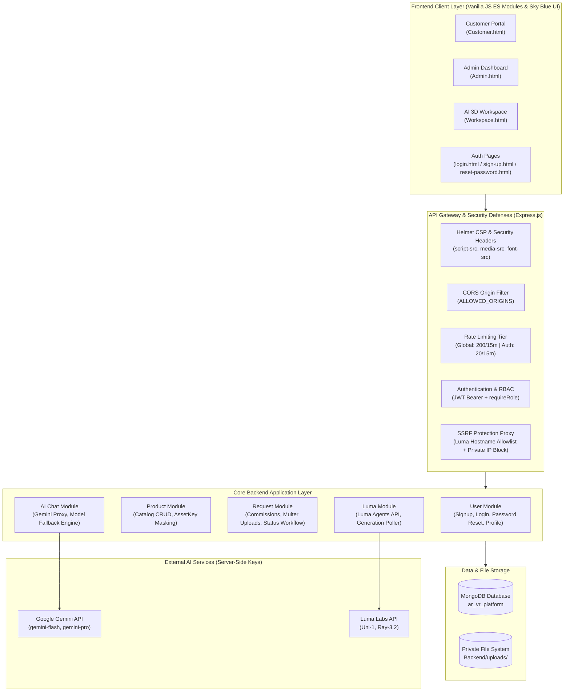
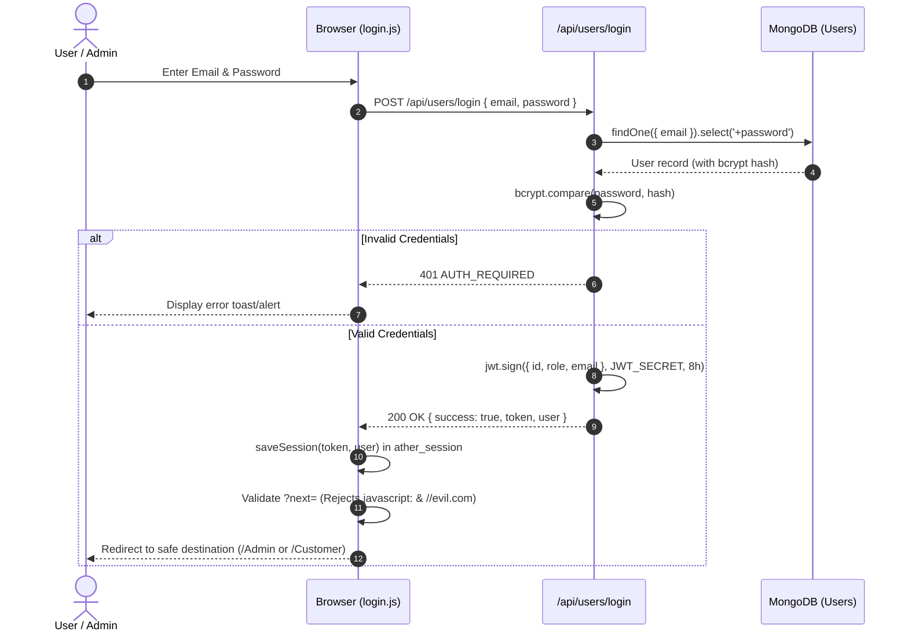
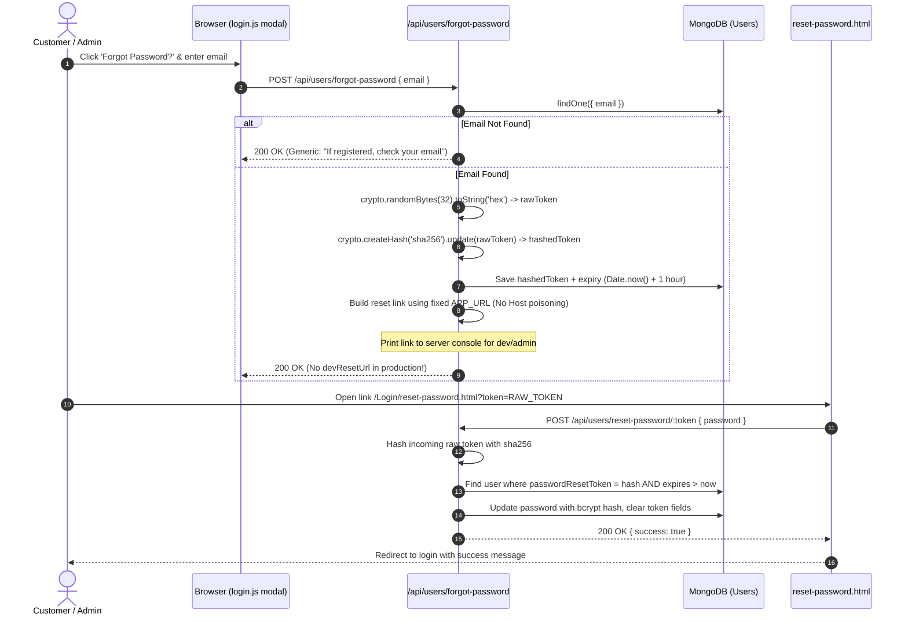
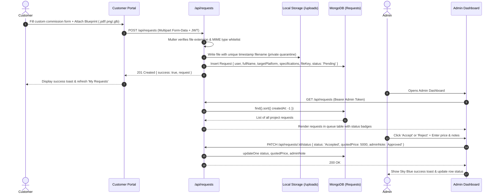
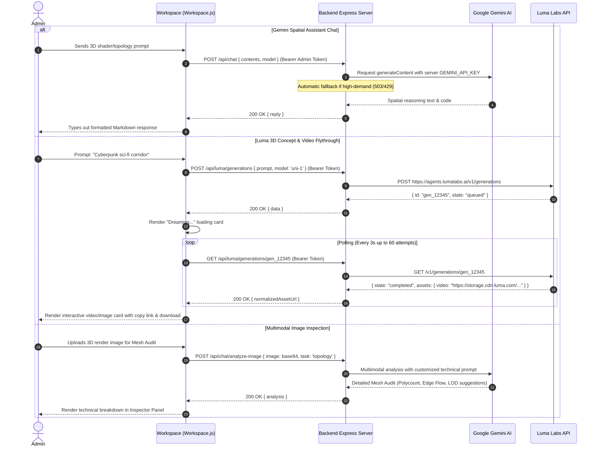

# Ather3D — Full System Architecture, Workflow & Technical Reference Manual

---

## 1. Executive Summary & Project Purpose

### What is Ather3D?
**Ather3D** is an advanced, production-hardened platform engineered for purchasing, configuring, inspecting, and commissioning **AR/VR 3D Models, Spatial Environments, and Digital Twins**. 

### What You Are Building & Implementing
You are building an end-to-end commercial AR/VR platform combining:
1. **A Customer Facing Portal** (`/Customer/Customer.html`): Where 3D artists, game developers, architects, and VR creators browse high-fidelity 3D assets, submit custom Commission Orders with specifications and blueprint files, and track project status in real time.
2. **An Administrative Dashboard** (`/Admin/Admin.html`): A command center styled in a modern **Sky Blue & White** aesthetic where administrators review incoming client project briefs, download blueprint attachments, accept/reject requests, issue cost estimates, and manage the live 3D asset catalog.
3. **An AI 3D Spatial Workspace** (`/Admin/Workspace.html`): An integrated AI spatial studio featuring:
   - **Google Gemini Spatial Chat**: Assisting with WebGL shaders, Three.js scene graphs, Draco compression, PBR material topologies, and LOD budgets.
   - **Gemini Multimodal 3D Vision Audit**: Inspecting uploaded 3D renders or texture sheets to analyze polycount budgets, UV packing, and edge flow.
   - **Luma AI Generative Synthesis**: Synthesizing generative 3D concepts, PBR textures, and spatial video flythroughs (via Ray & Uni models).
   - **Live 3D Viewport**: Built on Three.js & OrbitControls for interactive 3D inspection.
4. **Hardened Node.js + Express + MongoDB Backend**: Serving RESTful endpoints with enterprise-grade security (JWT RBAC, Helmet CSP, rate limiters, SSRF filters, input sanitizers).

---

## 2. High-Level Architectural Diagram



---

## 3. Core Workflows & Lifecycles

### Workflow A: Authentication & Session Management


### Workflow B: Secure Password Recovery Flow (Zero-Leak)


### Workflow C: Commission Request & Order Lifecycle


### Workflow D: AI Workspace 3D Generation & Inspection


---

## 4. Security Gateways & System Concepts Implemented

### 1. Content Security Policy (CSP) & Helmet Gateways
Located in `Backend/src/server.js`:
- **`scriptSrc`**: Allowed `'self'`, `'unsafe-inline'`, `https://cdnjs.cloudflare.com` (Three.js), and `https://cdn.jsdelivr.net` (OrbitControls).
- **`connectSrc`**: Strictly set to `["'self'"]`. All AI operations (Gemini, Luma) MUST route through backend endpoints. The browser is blocked from communicating directly with external AI services, protecting API keys from exposure.
- **`mediaSrc`**: Allowed `'self'`, `blob:`, `https://storage.cdn-luma.com`, `https://*.lumalabs.ai`, and `https:` to allow streaming of Luma-generated spatial videos.
- **`scriptSrcAttr`**: Set to `["'unsafe-inline'"]` to allow smooth execution of dashboard utility actions.

### 2. Tiered Rate Limiting Gateway
- **Global Limiter**: 200 requests per 15-minute window per IP (protects API resources against DoS).
- **Auth Limiter**: 20 requests per 15-minute window on `/api/users/*` (prevents brute-force credential stuffing and password reset spam).

### 3. Role-Based Access Control (RBAC) Gateway
- `authenticate.js`: Verifies the standard `Authorization: Bearer <token>` header, decodes the payload, and attaches `req.user`.
- `requireRole('admin')`: Restricts administrative routes (`/api/products` writes, `/api/requests` all, `/api/chat`, `/api/luma`). Customers attempting access receive `403 FORBIDDEN`.

### 4. Server-Side Request Forgery (SSRF) Defense Gateway
Located in `/api/chat/proxy-image`:
- **Hostname Allow-list**: Only permits known Luma CDN hostnames (`storage.cdn-luma.com`, `cdn.lumalabs.ai`, `assets.lumalabs.ai`, `storage.lumalabs.ai`).
- **Private IP Blacklist**: Regex filter (`/^(10\.|172\.(1[6-9]|2\d|3[01])\.|192\.168\.|127\.|169\.254\.|::1$|fc|fd)/i`) blocks attacks against AWS metadata services (`169.254.169.254`) and internal microservices.

### 5. Open Redirect & Script Injection Protection
Located in `Front-end/Login/login.js`:
- Validates `?next=` return paths using regex:
  ```javascript
  if (decoded.startsWith('/') && !decoded.startsWith('//') && !decoded.startsWith('/\\') && !/^[a-zA-Z][a-zA-Z0-9+.-]*:/.test(decoded)) {
    safeNext = decoded;
  }
  ```
- Neutralizes malicious injection like `?next=javascript:...` or phishing redirects `?next=https://malicious-site.com`.

### 6. XSS Sanitization & DOM Safety
- `toast.js`: Switched from raw `innerHTML` to explicit DOM creation (`document.createElement('span')`, `textContent = message`).
- `Customer.js`: Added an `escapeHtml()` helper sanitizing all user-submitted specifications and admin notes before rendering cards.
- `reset-password.js`: Uses `span.textContent` for alert notifications.

### 7. Data Masking & Private Storage
- **Password Masking**: `password` field on `User` schema is marked `select: false`. It is never returned in `.find()` queries.
- **Asset Key Protection**: Public product catalog calls `/api/products` explicitly project away internal digital asset keys (`assetKey`).
- **Private File Quarantine**: Uploaded client blueprints (`/uploads`) are intentionally **NOT** served statically. They can only be accessed through authenticated download controllers.

---

## 5. UI Theme System — Sky Blue & White Palette

Both the Admin Panel (`Admin.css`) and AI 3D Workspace (`Workspace.css`) feature a clean **Sky Blue & White** color palette:

| Token | Hex Code | Purpose |
|---|---|---|
| `--primary-sky` | `#0284C7` (Sky 600) | Brand badges, primary buttons, active states, icons |
| `--primary-sky-hover` | `#0369A1` (Sky 700) | Button hover states, deep interactive accents |
| `--primary-sky-light` | `#38BDF8` (Sky 400) | Badges, borders, highlights, subtle glow |
| `--primary-sky-subtle` | `#E0F2FE` (Sky 100) | Active pill background, selected tab surface |
| `--accent-sky` | `#0EA5E9` (Sky 500) | Send buttons, live status indicators |
| `--accent-sky-glow` | `rgba(14, 165, 233, 0.35)` | Box shadows, button focus rings |
| `--bg-canvas` / `--bg-light` | `#FFFFFF` | Crisp white main workspace canvas & card surfaces |
| `--border-light` | `#E2E8F0` | Subtle clean card borders and dividers |

---

## 6. Directory Structure & File Role Map

```
MajorApp/
├── Backend/
│   ├── uploads/                     ← Private quarantine for uploaded blueprint files
│   └── src/
│       ├── server.js                ← Express app, Helmet CSP, CORS, routes & static mounting
│       ├── config/
│       │   └── db.js                ← MongoDB connection logic via Mongoose
│       ├── middleware/
│       │   ├── authenticate.js      ← JWT verification & requireRole middleware
│       │   └── errorHandler.js      ← Centralized error handler with stable error codes
│       ├── scripts/
│       │   ├── seedAdmin.js         ← Initial administrative account seeder
│       │   ├── test_api.js          ← Legacy API unit tests
│       │   ├── test_everything.js   ← Master end-to-end automated test suite (32 tests)
│       │   └── update_theme.js      ← Script applying the Sky Blue & White theme
│       └── Modules/
│           ├── User/                ← Auth: signup, login, /me, forgot & reset password
│           ├── Product/             ← 3D model listings, drafts, published catalog
│           ├── Request/             ← Custom commission orders, file attachments, approval queue
│           ├── Chat/                ← Gemini spatial chat proxy, multimodal image audit, SSRF proxy
│           └── Luma/                ← Luma AI 3D generations, model status, polling loop
├── Front-end/
│   ├── Login/
│   │   ├── login.html / login.js    ← Customer login with validated ?next= redirect & modal
│   │   ├── sign-up.html / .js       ← Customer registration
│   │   ├── reset-password.html / .js← Secure token-based password reset interface
│   │   └── login.css                ← Form styling
│   ├── Admin/
│   │   ├── Admin.html / Admin.js    ← Admin approval queue, catalog management, modal controllers
│   │   ├── Admin.css                ← Sky Blue & White theme styles for Admin Dashboard
│   │   ├── Workspace.html / .js     ← AI 3D Studio, Gemini chat, Luma generation, 3D viewport
│   │   └── Workspace.css            ← Sky Blue & White theme styles for AI Workspace
│   ├── Customer/
│   │   ├── Customer.html / .js      ← Catalog browser, commission submission, My Requests queue
│   │   └── Customer.css             ← Customer portal styling
│   └── shared/
│       ├── api.js                   ← Central fetch client with automatic Bearer token & 401 handling
│       ├── auth.js                  ← Unified session storage (ather_session)
│       ├── guard.js                 ← Page protection guards (requireLogin, requireAdmin)
│       ├── tokens.css               ← Base design tokens
│       └── ui/
│           └── toast.js             ← XSS-safe lightweight non-blocking toast notifications
├── Readme/
│   ├── README.md                    ← Main documentation index
│   ├── Architecture.md              ← System architecture summary
│   ├── API_Reference.md             ← Complete REST API endpoint reference
│   ├── Setup_Guide.md               ← Step-by-step developer deployment guide
│   └── SYSTEM_ARCHITECTURE_AND_WORKFLOW.md ← This comprehensive reference manual
├── package.json                     ← Project dependencies and scripts
└── .env                             ← Environment configuration (Production, Secrets)
```

---

## 7. Developer Runbook & Common Operations

### Starting the Server
```bash
# Production Mode
node Backend/src/server.js

# Development Mode with auto-restart
npm run dev
```
Server runs on: **`http://localhost:5000`**

### Running the Master Automated Test Suite
A master test script validates all 32 critical subsystems:
```bash
node Backend/src/scripts/test_everything.js
```
**Tests Covered:**
- Health check & API basics
- Static delivery of all 6 HTML frontend pages
- Helmet CSP verification (`cdn.jsdelivr.net`, `script-src-attr`, `media-src` Luma CDN)
- Admin login and JWT role verification
- Customer signup, duplicate email rejection, and login
- Zero-leak password reset flow (validates that `devResetUrl` is NOT leaked in production)
- Customer commission submission, client-side tracking (`/api/requests/mine`), and Admin approval
- Asset key protection (verifies `assetKey` is never exposed in public catalog responses)
- RBAC guards (verifies 401/403 blocks for unauthorized AI and admin endpoints)

### Seeding the Admin Account
```bash
node Backend/src/scripts/seedAdmin.js
```
Default seeded credentials:
- **Email:** `ather3dadmin@gmail.com`
- **Password:** Configured via `ADMIN_PASSWORD` in `.env` (Default: `Ather3D@Admin2026`)

---

*Document compiled and verified for Ather3D Production Deployment.*
